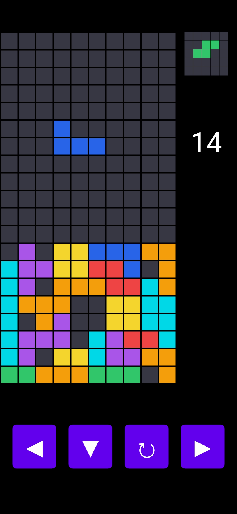
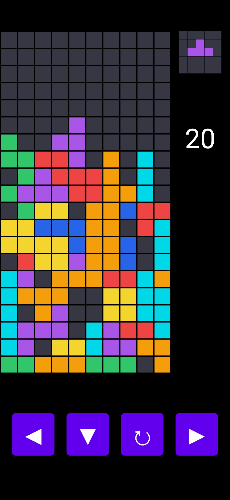
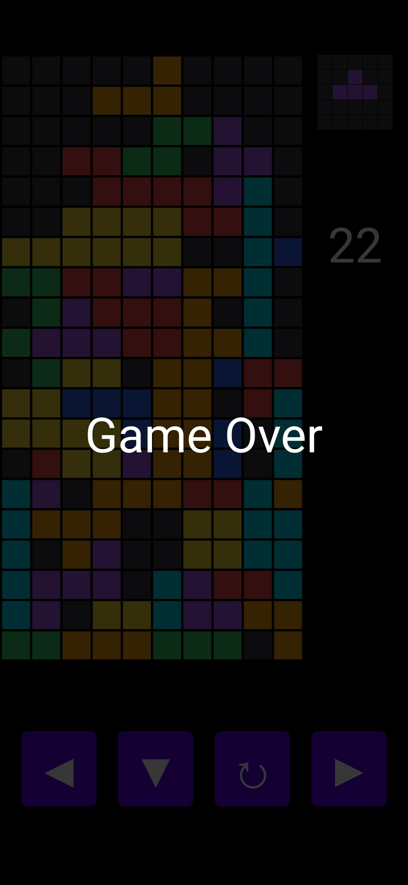

# Block Puzzle

A simple block puzzle game built with **Java and Processing (APDE)**.

Arrange falling blocks, complete horizontal lines, and keep the playing field clear for as long as possible. Plan your moves carefully as the game gets progressively more challenging.

## Features

- Grid-based gameplay
- Multiple block shapes
- Block rotation and movement
- Line-clearing mechanics
- Collision detection
- Score tracking
- Custom rendering using Processing

## Screenshots

|                Gameplay 1                |                Gameplay 2                |                Game Over                 |
|:----------------------------------------:|:----------------------------------------:|:----------------------------------------:|
|  |  |  |

## Built With

- **Java** – Game logic and implementation
- **Processing** – Graphics and rendering
- **APDE** – Android development environment for Processing

## Getting Started

1. Clone this repository.
2. Open the project using APDE.
3. Build and run the project on your Android device.

## Project Purpose

This project was built as a hands-on exercise in game development, focusing on implementing game mechanics, grid-based movement, collision detection, and rendering without relying on a pre-built game engine.